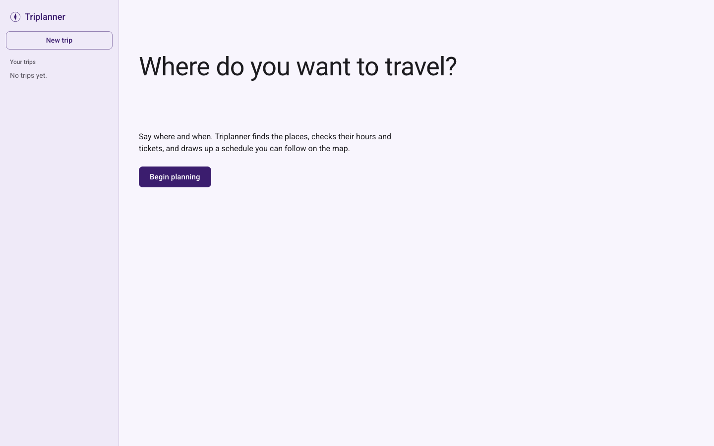
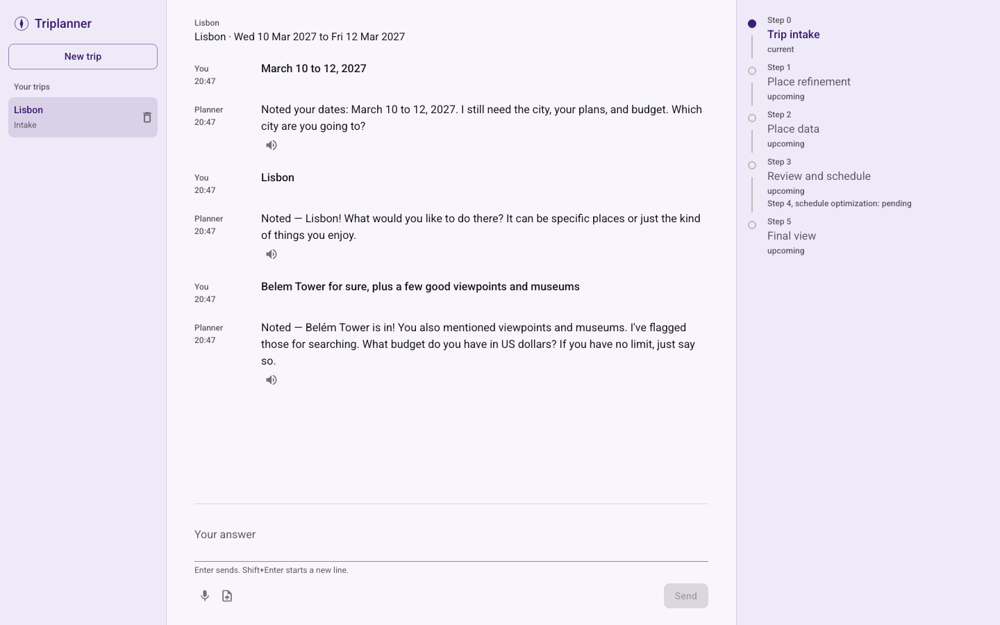
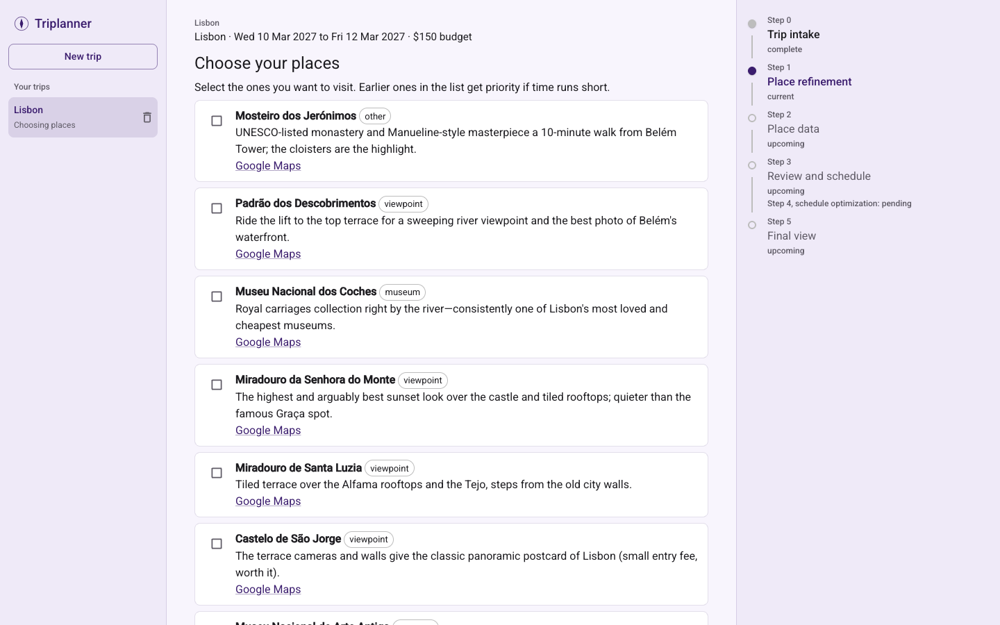
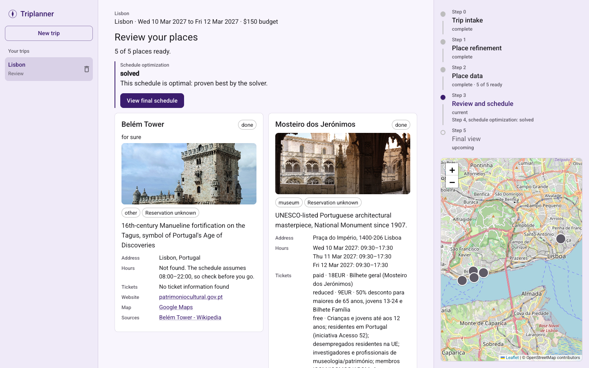
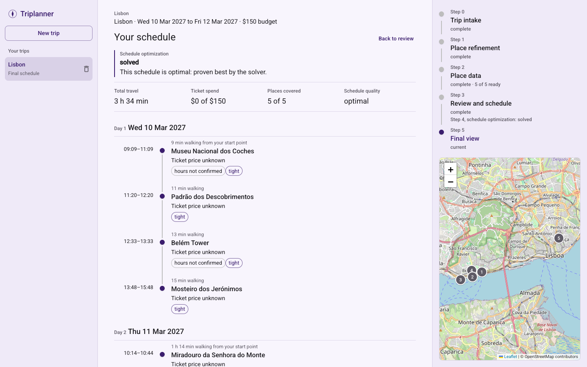

# Triplanner

[](https://youtu.be/hgZqPLEmYHA)

[Watch the full demo with sound (53 s)](https://youtu.be/hgZqPLEmYHA)

## Setup

You need Node 24.9.0 and pnpm 12.6.0.

```bash
pnpm run bootstrap        # installs everything and creates .env
# set APEX_API_KEY in .env
pnpm dev
```

Open http://127.0.0.1:5173.

To try it without a key, run `pnpm run seed:demo` while `pnpm dev` is running, then open http://127.0.0.1:5173/trips/demo-paris. This is the trip shown above. Its hours and prices are made up.

## What this is

A trip planner. A chat collects your dates, city, plans and budget. Bots read each place's web pages for hours and tickets using Apex, an LLM. An optimizer (AMPL with HiGHS) then builds a schedule, shown on a timeline and a map.

## Commands

| Command              | What it does                                          |
| -------------------- | ----------------------------------------------------- |
| `pnpm run bootstrap` | Install dependencies, AMPL and MongoDB; create `.env` |
| `pnpm dev`           | Start MongoDB, backend and frontend                   |
| `pnpm run check:env` | Show what is working and what is missing              |
| `pnpm run seed:demo` | Load the Paris demo trip                              |
| `pnpm test:fast`     | Run tests that need no network or key                 |
| `pnpm test`          | Run all tests, including real Apex calls              |
| `pnpm run typecheck` | Type check everything                                 |

Other settings are in [.env.example](.env.example).

## How to use

**1. Start.** Click **Begin planning**.



**2. Answer the chat.** Give your dates, city, plans and budget. Name places, describe what you like, or both. You can also use the microphone or upload audio, in English.



**3. Choose places.** Tick the suggestions you want, then click **Confirm these places** at the bottom. Places you named are always included. If you only named places, this step is skipped.



**4. Review.** Cards fill in with hours and tickets while the schedule is solved. Then click **View final schedule**.



**5. Follow the schedule.** Numbers on the map match the order of visits. Check any visit marked **hours not confirmed** before you go. Ticket prices the bots could not read count as $0, so the spend total can be too low.


